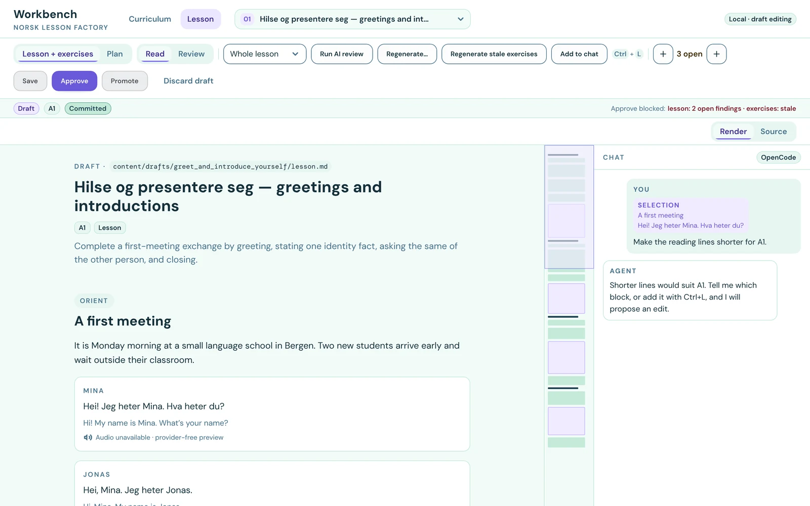
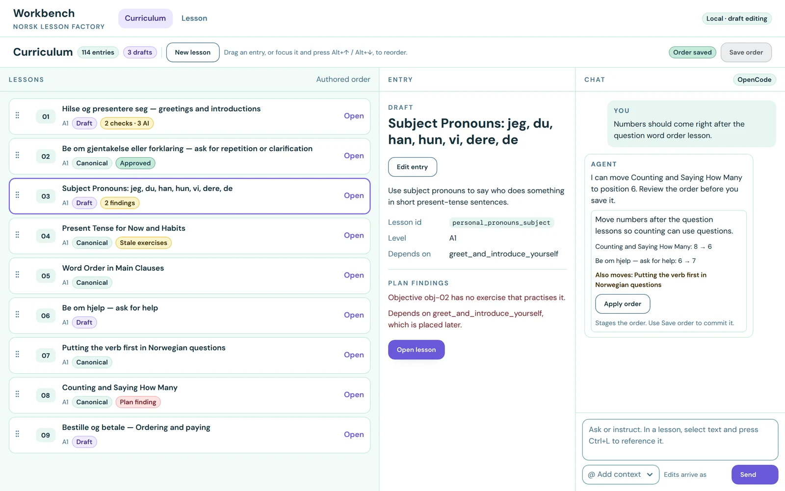

# norsk-lesson-factory

Norwegian Bokmål lesson data and the authoring tools used to maintain it. Lessons
combine learning objectives, explanations, examples, and exercises covering
grammar, phraseology, and everyday communication.

Use the JSON distribution in a learning application, or edit the Markdown and
YAML sources in this repository. This repository owns lesson content and
assessment criteria; consuming applications own presentation, playback, learner
progress, and scoring behavior.



## Use the lesson data

Download `lessons.tar.gz` from [GitHub
Releases](https://github.com/Chalvin96/norsk-lesson-factory/releases), or use the
checked-in [`dist/`](dist/) directory. Pin a release tag or commit when
integrating the data.

| File | Purpose |
| --- | --- |
| [`dist/catalog.json`](dist/catalog.json) | Lesson IDs, curriculum positions, and family metadata |
| [`dist/lessons/`](dist/lessons/) | One JSON packet per lesson |
| [`dist/schema/lesson.schema.json`](dist/schema/lesson.schema.json) | Public lesson-packet schema |

Each packet includes metadata, objectives, teaching sections, exercises, and a
`content` list specifying their authored order. Exercises include choices,
matching, categorization, sentence building, gap filling, error identification,
and written responses.

With `jq` installed, inspect the catalog and a lesson from the repository root:

```bash
jq -r '.lessons[] | [.position, .lesson_id, .family_id] | @tsv' dist/catalog.json
jq '{id, title, cefr_level, goal}' dist/lessons/modal_verbs_basic.json
```

## Set up a development checkout

Install Git, Python 3.12+, `uv`, and Node.js. Python dependencies and development
tools are managed by `uv`; Node.js is used by repository checks and the
workbench frontend tooling.

```bash
git clone https://github.com/Chalvin96/norsk-lesson-factory.git
cd norsk-lesson-factory
uv sync --locked
npm --prefix workbench ci
git config core.hooksPath .githooks
uv run lesson-data --help
```

The CLI exposes five commands: `check`, `regenerate-dist`, `release`,
`release-verify`, and `workbench`. `check` validates workspace source and the
committed distribution. `regenerate-dist` builds the provider-free JSON
projection. The workbench is the local authoring and inspection surface.

## Edit and inspect lessons

Run the loopback-only workbench and open the printed URL:

```bash
uv run lesson-data workbench
```



The workbench supports draft editing, local Save commits, chat proposals, AI
review, promotion to provider-free `dist/`, and checkpointed
lesson and exercise regeneration. Inspect at 1280 px and 320 px; lesson and chat
panes stack on narrow screens. Opening and inspecting source does not call a
provider. Chat, review, and regeneration actions can use configured providers.

After source changes, regenerate and check the distribution:

```bash
uv run lesson-data regenerate-dist --repo-root .
uv run lesson-data check --workspace-root . --format json
```

Include intentional `dist/` changes with their source changes. The complete
offline suite is available with `npm run check`; it also regenerates `dist/` and
checks for drift. These checks establish structural consistency; linguistic
and pedagogical quality still require review.

The frontend lives in `workbench/` (React, Tailwind, shadcn). Run
`npm run workbench:storybook` to inspect its pages and components, and
`npm run workbench:build` after frontend changes to rebuild the app shipped in
the Python package.

## Create and review drafts

Pipeline jobs run on OpenCode, while workbench chat runs on the Codex app-server.
Generation and AI review require the configured OpenCode CLI and authenticated
provider access. Configure model routes and authoring jobs in [`config.yaml`](config.yaml).
Generation results arrive as proposals; source changes only after the owner
accepts them. When lesson changes leave exercises stale, **Regenerate stale
exercises** creates one proposal with a block per stale exercise, which the owner
can accept or reject item by item.

For optional model-dependent prompt evaluations:

```bash
npm run eval:promptfoo -- -c evals/promptfoo/reviews.yaml
```

## Release

Standard releases use the local plan and approval flow because only the operator's
workspace has the audio cache and publication credentials. Follow the
[Release Operations Runbook](knowledge/README.md). Start with
`uv run lesson-data release`, review audio reuse, missing recordings, and
estimated synthesis cost, then run the printed `release --approve` continuation
only when synthesis and publication are authorized. Tag CI runs
`lesson-data release-verify` against that published release; it does not
synthesize or publish.

## Repository layout

| Path | Contents |
| --- | --- |
| [`content/catalog/`](content/catalog/) | Approved lesson inventory and family registry |
| [`content/curriculum/`](content/curriculum/) | Curriculum plan and sequence |
| [`content/lessons/`](content/lessons/) | Editable lesson packages |
| [`content/authoring/`](content/authoring/) | Shared character authoring data |
| [`dist/`](dist/) | Generated catalog, lesson packets, and public schema |
| [`src/lesson_builder/`](src/lesson_builder/) | CLI, authoring, review, export, and release code |
| [`tests/`](tests/) and [`scripts/`](scripts/) | Behavior tests and repository checks |
| [`evals/promptfoo/`](evals/promptfoo/) | Optional model-dependent evaluations |
| [`knowledge/`](knowledge/) | Current domain and architecture decisions |
| `store/` | Ignored local drafts, checkpoints, and caches |

## Contribute

For content corrections, include enough context to explain the problem and keep
lesson prose, prompts, answers, and feedback consistent. Report issues through
the [public issue tracker](https://github.com/Chalvin96/norsk-lesson-factory/issues).

Read [AGENTS.md](AGENTS.md) for contributor conventions and the [knowledge
index](knowledge/index.md) for current design decisions. Before adding lessons or
changing their scope, read [authoring decisions](knowledge/pipeline/authoring.md)
and [source and distribution boundaries](knowledge/project/boundaries.md).
Include validation commands and results in your pull request.

Report vulnerabilities privately using the guidance in [SECURITY.md](SECURITY.md).

## Licenses and attribution

- **Lesson data:** `content/`, `dist/catalog.json`, and `dist/lessons/` are
  licensed under [CC BY 4.0](LICENSE-DATA.md). Credit the project and identify
  changes when adapting or redistributing the data; the license file supplies
  attribution wording and provenance details.
- **Code and other materials:** everything else, including documentation and
  `dist/schema/`, is licensed under [MIT](LICENSE).

The shipped lessons were produced with LLM-assisted authoring and reviewed
through the repository's human and automated workflow. See
[LICENSE-DATA.md](LICENSE-DATA.md) for the full scope and third-party attribution.
